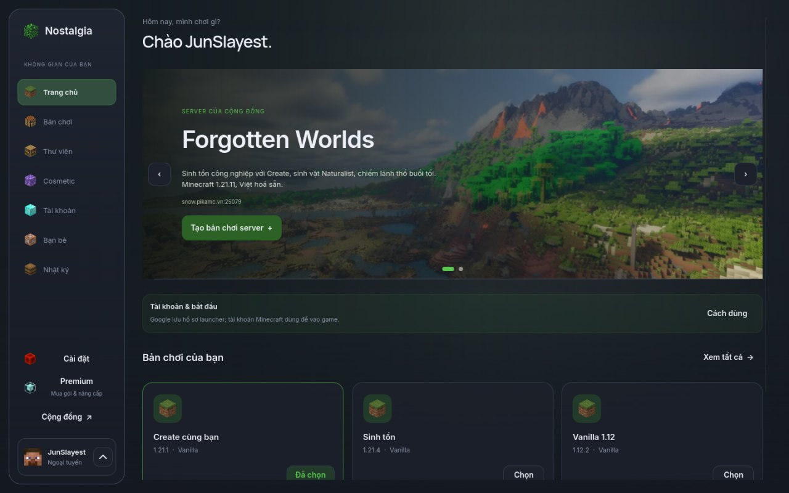
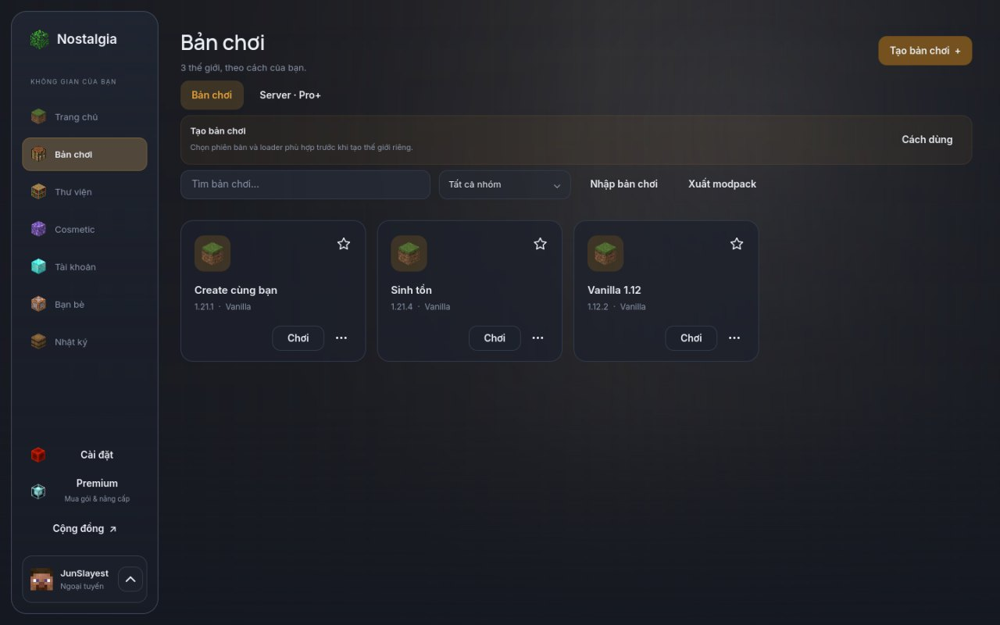
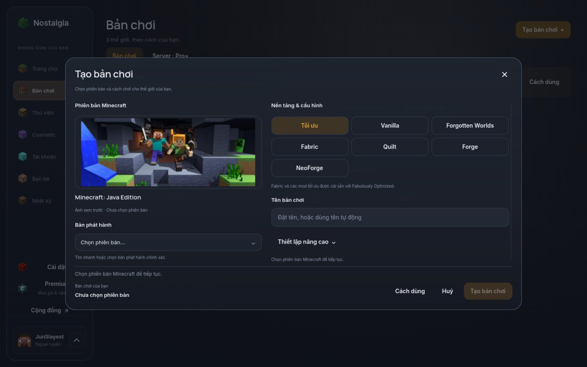
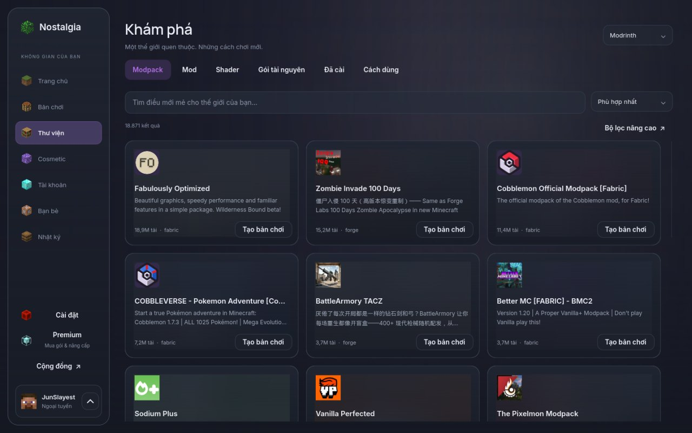
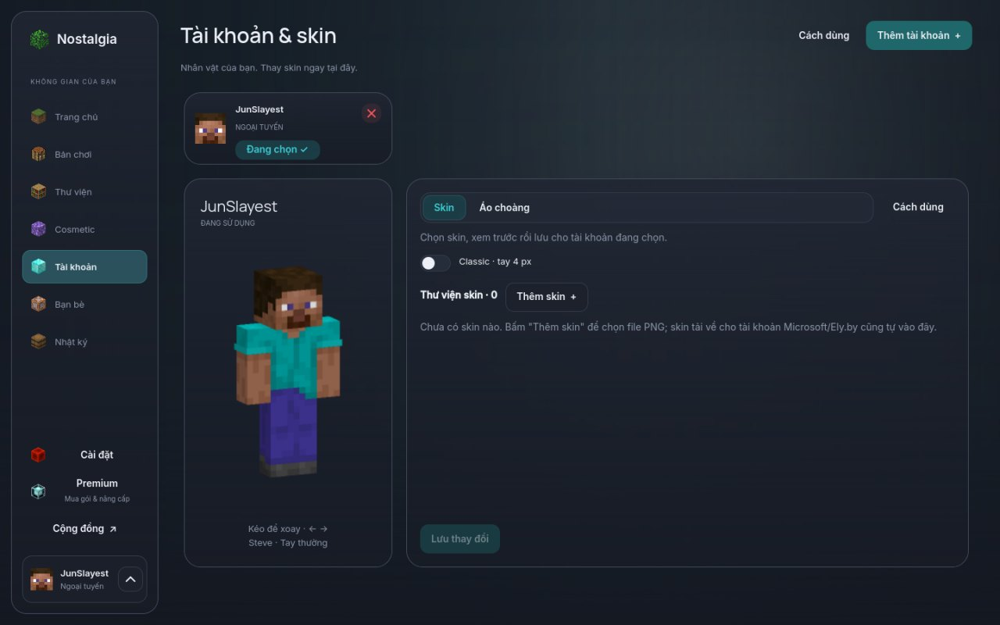
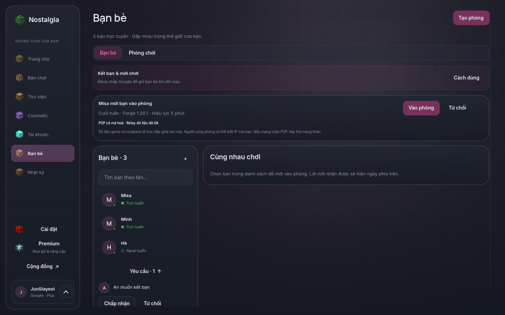
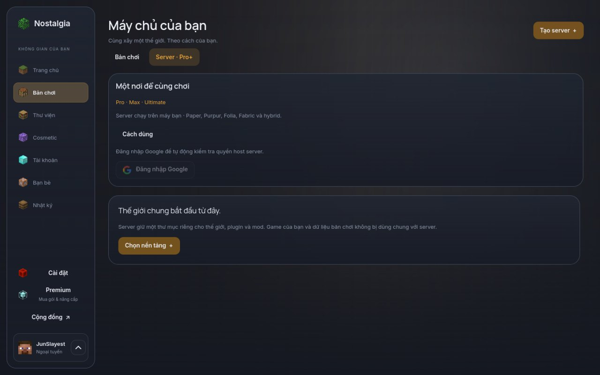
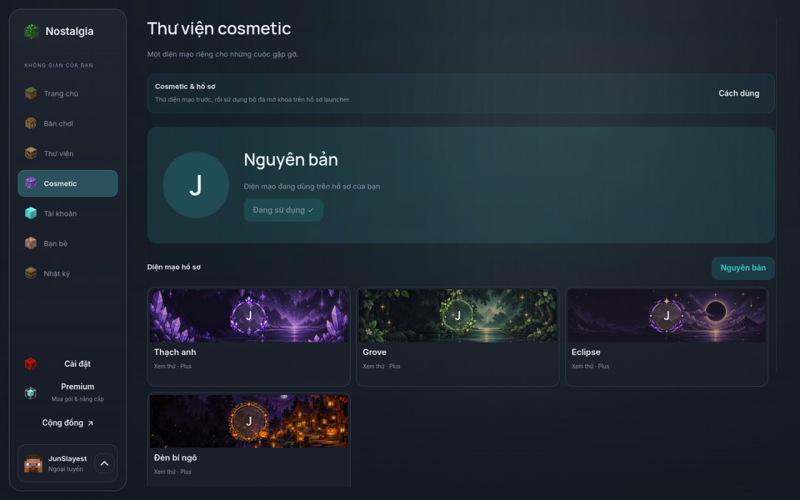
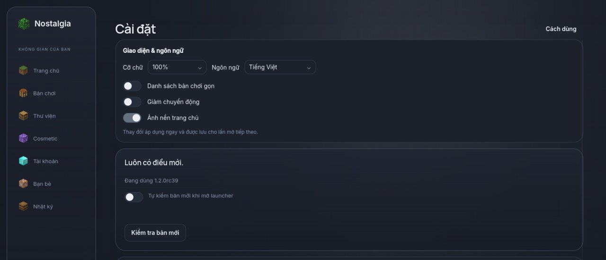

<div align="center">


# Nostalgia Launcher

### A Minecraft launcher rebuilt from zero — for the feeling of coming home.

Sign in, pick a version, press **CHƠI**. Everything else — Java, loaders, mods, modpacks,
skins, friends, updates — is already taken care of.




**[⬇️ Download page](https://junxmas.github.io/NostalgiaLauncher/)** — it detects your OS and
hands you one file.
&nbsp;·&nbsp;
[All releases](https://github.com/JunXmas/NostalgiaLauncher/releases/latest)

</div>

---

## Why this exists

I built my first Minecraft launcher in August 2026. It was my very first real project, and I
loved it — the frosted glass, the little home screen, the feeling that opening a program
could be a tiny event again. People were kind about it. It also had rough edges everywhere,
because I was learning while I typed.

So I did the scary thing: **I started over.** Same name, same heart, none of the old code.

This repository is that second attempt. It was written step by step, one pull request at a
time, with a rule I did not have the first time: *nothing ships without a test that proves it.*
Since 1.0 the launcher has grown a whole new face — a calm glass sidebar, real Minecraft
blocks for icons, friends, rooms, servers — and more than two thousand tests underneath. It is
not finished (a launcher never is), but for the first time I am not afraid of what is
underneath the paint.

Welcome back. Nostalgia is the point. 💚

---

## A look inside

### 🏠 Home — "What are we playing today?"


The home page opens on a slideshow. The first slide is our community server,
**Forgotten Worlds**, with real screenshots from the server rotating behind it: one button
creates the matching instance, the next time it jumps you straight into
`snow.pikamc.vn:25079`, and when the server's modpack has a new version the button turns into
**Update modpack**. Below it: your instances, one click from playing. The sidebar icons are
rendered from Minecraft's own block models — grass, barrel, bookshelf, amethyst, diamond.

### ⛏ Instances, and a create dialog with a face



Every instance is a card: play, favorite, group, search, import a `.mrpack`/`.zip`, or
**export** one back out as a Modrinth `.mrpack` or a plain ZIP for a friend.



Pick a Minecraft version and the dialog shows that generation's official key art. Choose a
platform — **Optimized** (Fabric + Fabulously Optimized for the best FPS), Vanilla, **Forgotten
Worlds**, Fabric, Quilt, Forge or NeoForge — and open *Advanced* for RAM and a game folder on
**any disk you like**. Forgotten Worlds is industrial survival with Create, JEI and Naturalist
on Minecraft 1.21.11, Vietnamese translation on by default; see
[the pack documentation](docs/FORGOTTEN_WORLDS.md) for every pinned mod. Updating a pack keeps
your worlds, settings and the mods you added yourself, and rolls back if a download fails.

### 📚 Library — Modrinth and CurseForge, no API key



Modpacks, mods, shaders and resource packs from **Modrinth** and **CurseForge** in one search.
Pick the instance and the launcher chooses the newest stable file that matches its Minecraft
and loader — or open *Change version* to pick one yourself. CurseForge requests go through the
project's own tiny proxy, so you never have to create or paste an API key. Drop a `.mrpack`
or `.zip` anywhere on the window and it becomes an instance.

### 👤 Accounts and skins



Microsoft, [Ely.by](https://ely.by) and offline accounts side by side, with a full-body
preview you can drag to turn around. Skins and capes have a preview-then-**Save** flow per
account, Classic/Slim switches the model instantly, and every skin the launcher meets lands in
your **skin library**. Ely.by accounts go through authlib-injector, and the injector jar is
verified by SHA-256 before it is ever handed to Java.

### 🤝 Friends and rooms — play together, peer to peer



Sign in with Google once and your friends follow you to any computer. See who is online,
chat, send an invite. **Create a room**, pick the instance, open your world to LAN, and invite
friends straight from the room panel — they get a **Join room** button and their game sees your
world as if you shared the same Wi-Fi.

Game traffic and custom mod files travel **directly between the two computers** over
WebRTC, encrypted with DTLS; the server only helps the two sides find each other. Shared files
are checked by size and SHA-256 before anything is installed. The threat model and the tests
that enforce it are in [`docs/MULTIPLAYER_SECURITY.md`](docs/MULTIPLAYER_SECURITY.md).

### 🖥 Your own server



The *Server* tab installs and runs a Minecraft server **on your own machine** — Paper,
Purpur, Folia, Fabric, Vanilla or an Arclight hybrid — from official, pinned builds with
checksums verified before launch. Settings, plugins/mods, a live console and the raw files
each have their own page. (Part of the Pro, Max and Ultimate plans; no VPS is included.)

### ✨ Cosmetics



Profile frames and banners — Amethyst, Grove, Eclipse, Jack-o'-lantern — that your friends see
next to your name. Try any of them on before using it.

### ⚙ Settings, auto-update, Discord



**Vietnamese and English**, text size up to 150 %, compact lists, reduced motion, and a switch
for the home artwork. Auto-update checks GitHub at startup (switchable), downloads over HTTPS,
verifies the release's `SHA256SUMS`, and only installs after you press *Update now* — on
Windows it even asks for UAC when the launcher lives in a protected folder. Discord Rich
Presence works out of the box, the game log streams live with warning/error filters, and a
default folder for new instances lets you keep the whole library on a second drive.

---

## What's new since 1.0

- 🪟 **A new interface**: glass sidebar, Minecraft block icons, slideshow home, smoother lists that only build what is on screen.
- 🌍 **Vietnamese and English**, switchable on the login screen or in Settings.
- 🏔 **Forgotten Worlds** — a built-in modpack for the community server, with in-place updates and a heads-up when a new version ships.
- 🤝 **Google sign-in, friends, chat and invites**, plus rooms that connect **peer to peer** (encrypted WebRTC) instead of through a relay.
- 🖥 **Server manager** for Paper / Purpur / Folia / Fabric / Vanilla / Arclight on your own PC.
- 📦 **Export** any instance as `.mrpack` or ZIP; **permanent delete** with confirmation; old backups still restorable.
- 🎨 Skin and cape preview with **Save**, and profile **cosmetics**.
- 💎 **Premium plans** (Plus, Pro, Max, Ultimate) for extras like modpack sync in rooms and the server manager. Everything the launcher did before stays free.
- 🍎 **macOS builds** for Apple Silicon and Intel.

---

## Get it

**Packaged** — pick your platform on the
[Releases page](https://github.com/JunXmas/NostalgiaLauncher/releases/latest). Every file is
built by GitHub Actions from a tagged commit, smoke-tested on that OS, and listed in `SHA256SUMS`.

| Platform | File |
|---|---|
| Linux, any distro (glibc ≥ 2.35) | `nostalgia-<ver>-linux-x64.AppImage` — `chmod +x`, run |
| Debian / Ubuntu / Mint / Pop!_OS | `nostalgia_<ver>_amd64.deb` — `sudo apt install ./…deb` |
| Fedora / openSUSE / RHEL / Nobara | `nostalgia-<ver>-1.x86_64.rpm` — `sudo dnf install ./…rpm` |
| Linux, portable | `nostalgia-<ver>-linux-x64.tar.gz` or `.zip` |
| macOS Apple Silicon | `nostalgia-<ver>-macos-arm64.dmg` — drag to Applications |
| macOS Intel | `nostalgia-<ver>-macos-x64.dmg` |
| Windows 10/11 | `nostalgia-<ver>-windows-x64-setup.exe` — no admin needed |
| Windows, portable | `nostalgia-<ver>-windows-x64.zip` |

The builds are not code-signed yet: macOS asks you to right-click → *Open* the first time, and
Windows SmartScreen wants *More info → Run anyway*. Linux and Windows packages update themselves
in place; on macOS the launcher tells you when a new `.dmg` is ready.

**From source** — needs Python 3.12+ and [uv](https://docs.astral.sh/uv/):

```sh
git clone https://github.com/JunXmas/NostalgiaLauncher.git
cd NostalgiaLauncher
uv sync --extra ui
uv run nostalgia-ui
```

The core also works without a window at all:

```sh
uv run nostalgia account add-offline Jun
uv run nostalgia install 1.20.1
uv run nostalgia instance create vui-ve --version 1.20.1
uv run nostalgia play vui-ve --account Jun
```

> The interface speaks **Vietnamese** and **English** — pick one on the login screen or in Settings.

---

## The rework, honestly

| | Old `NostalgiaLauncher` (Aug 2026) | This repository (1.2, Oct 2026) |
|---|---|---|
| Codebase | one big Qt app, learned as I went | rewritten from an empty folder |
| Runtime dependencies | `PySide6`, `requests` | **none** for the core; the window adds PySide6 and a few small libraries |
| Tests | a handful | **2,000+**, run on Python 3.12 and 3.13 in CI |
| Architecture | everything talks to everything | layered; a test fails if a lower layer imports a higher one |
| UI ↔ engine | direct calls | one façade (`nostalgia.api`) — the UI cannot import anything else |
| File size | some files > 1,000 lines | every `.py` ≤ 200 lines of code, enforced by a test |
| Naming | whatever came to mind | a glossary of banned/required names, enforced by a test |
| Accounts | Microsoft, offline | Microsoft, **Ely.by**, offline (+ Google for friends) |
| Loaders | Vanilla, Fabric, Forge, NeoForge | + Quilt, + Optimized, + Forgotten Worlds |
| Multiplayer | — | friends, invites, peer-to-peer rooms |
| Skins | pixel editor, 3D model | library, preview, upload, apply; editor is coming back |
| Languages | 10 | Vietnamese, English |
| Builds | .exe / .dmg / .deb | AppImage, .deb, .rpm, setup.exe, .dmg (arm64 + x64), all with checksums |

What I kept: the name, the warm home screen, the idea that a launcher should do the boring parts
for you. What I gave up, for now: the pixel skin editor and most of the old translations. They
will return — but this time on top of something that does not fall over.

---

## Under the hood

- **Zero-dependency core.** Downloads, Microsoft/Ely.by auth, version manifests, natives,
  Java runtimes, modloader installers — all on `http.client` and the standard library. It is
  1.5× faster than `requests` under parallel downloads and starts faster, too
  ([`docs/PERFORMANCE.md`](docs/PERFORMANCE.md)).
- **Layers with a fence.** `tests/test_api_boundary.py` and friends fail the build if the
  UI imports anything but the façade, if a file grows past 200 lines, or if a banned name
  ([`GLOSSARY.md`](GLOSSARY.md)) sneaks in.
- **Security first.** Path traversal checks on every archive entry, SHA-256 on every downloaded
  jar and on every update, a network guard in the test suite so no test can touch the internet
  by accident, and multiplayer traffic that goes peer to peer, encrypted end to end.
- **Measured, not guessed.** `bench/` holds real probes — how many disk reads a click costs, how
  long the UI thread stalls when you expand a card (it used to be 200 ms; it is now under 1 ms).

Contributing notes live in [`CONTRIBUTING.md`](CONTRIBUTING.md); releases in
[`docs/RELEASE.md`](docs/RELEASE.md).

---

## Tiếng Việt

Nostalgia Launcher là trình khởi động Minecraft viết lại từ đầu sau dự án đầu tay cùng tên
(08/2026). Giao diện kính mới với icon khối Minecraft thật, trang chủ dạng băng trượt có server
cộng đồng **Forgotten Worlds** (tạo bản chơi, vào thẳng server, cập nhật modpack giữ nguyên thế
giới). Đăng nhập Microsoft / Ely.by / ngoại tuyến; loader Tối ưu / Vanilla / Fabric / Quilt /
Forge / NeoForge; thư viện modpack, mod, shader, gói tài nguyên từ Modrinth và CurseForge (không
cần khoá API); xuất bản chơi ra `.mrpack`/ZIP. Đăng nhập Google để kết bạn, chat, mời chơi;
phòng chơi kết nối **P2P mã hoá** giữa hai máy. Quản lý server ngay trên máy, cosmetic hồ sơ,
giao diện Tiếng Việt / English, tự cập nhật có kiểm SHA-256. Lõi không phụ thuộc thư viện ngoài;
hơn 2.000 test; mỗi file ≤ 200 dòng. Chi tiết từng bản ở [`CHANGELOG.md`](CHANGELOG.md).

---

## License

**[PolyForm Strict 1.0.0](LICENSE)** — source-available, not open source. The code is public so
anyone can read it and check that the launcher is safe. You may read, build and run it for any
noncommercial purpose, and change it on your own machine to test or audit it (see
[`NOTICE`](NOTICE)). You may **not** use it commercially, redistribute it, or publish modified
versions. Want to fix something? Send a pull request — that is allowed.

Releases up to and including 1.1.7 were published under AGPL-3.0, and copies of those versions
keep that license.

**Every line that runs on your machine is here.** This program holds your Microsoft login token;
software like that has no business being closed. The only pieces kept private are the two
Cloudflare Workers the project operates (they hold an API key) — what they do, and why you do
not have to trust them, is in [`cloudflare/README.md`](cloudflare/README.md).

Minecraft is a trademark of Mojang Studios / Microsoft. The key art in
`src/nostalgia/ui/qml/assets/keyart/` belongs to Mojang and is used for non-commercial
illustration only ([credits](src/nostalgia/ui/qml/assets/keyart/CREDITS.md)). This launcher is
not affiliated with Mojang or Microsoft.
